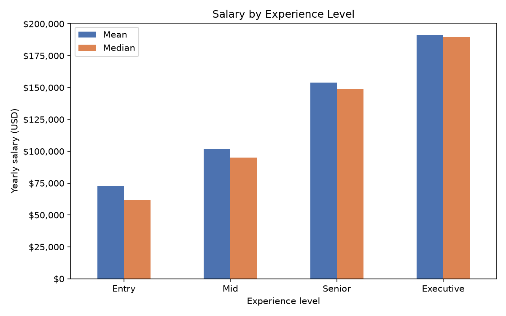
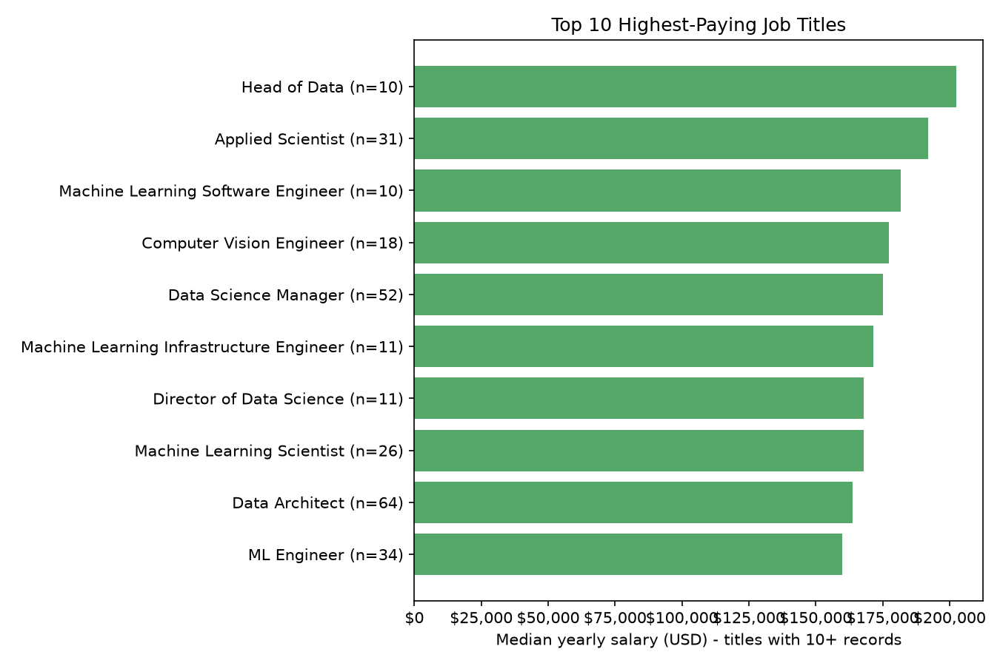
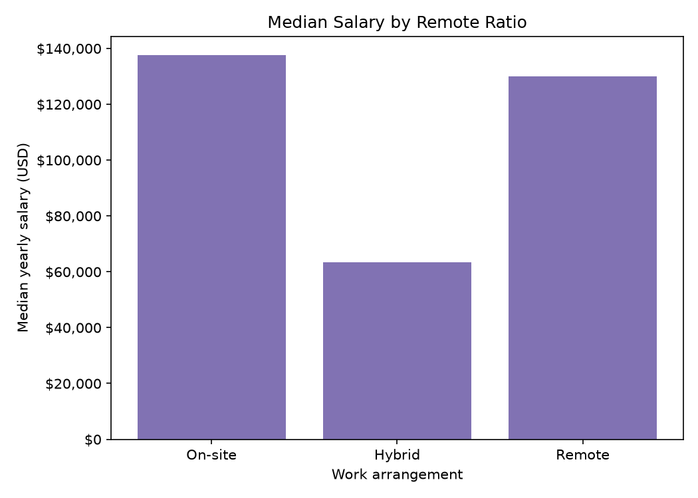

# Overview

This project analyses real salary data for data science, analytics and machine-learning jobs. I wrote it to practise the everyday workflow of a data analyst: load a raw CSV file, inspect and clean it, ask clear questions, answer them with Pandas, and present the evidence in charts.

**Dataset:** [Data Science Salaries 2023](https://www.kaggle.com/datasets/arnabchaki/data-science-salaries-2023) on Kaggle, shared by RandomArnab: 3,755 rows covering [2023]. Each row is one salary record with the job title, experience level, salary in USD, remote-work ratio, company size and country. [The dataset page describes the records as data science job salaries, and the author credits no further source]. My analysis removes 1,171 exact duplicate rows, leaving 2,584 records. on Kaggle, [3,755] rows covering [11]. Each row is one salary record with the job title, experience level, salary in USD, remote-work ratio, company size and country. [on the Kaggle page.]

**Why I wrote it:** I am building towards a career as a data analyst / engineer / scientist, and I wanted to see what this market actually pays and how pay changes with experience, job title and remote work. It also gave me hands-on practice with Pandas and Matplotlib.

**How to run it:**

1. Download the dataset from the link above and save the CSV as `data/ds_salaries.csv`.
2. Create and activate a virtual environment, then run `pip install -r requirements.txt`.
3. Run `python salary_analysis.py`. Tables print to the terminal and charts are saved to the `charts/` folder.

[Software Demo Video](https://youtu.be/GUhYZl5B0jQ)

# Data Analysis Results

**Question 1: How does average yearly salary (USD) change across experience levels?**

[Average salary rises at every step up in experience: from $72,649 for Entry (270 records) to $101,829 for Mid, $153,897 for Senior and $191,078 for Executive (96 records). The biggest jump is from Mid to Senior (+51.1%), followed by Entry to Mid (+40.2%) and Senior to Executive (+24.2%). Median salaries follow the same order ($61,900, $95,000, $148,800 and $189,618). At Entry level the mean is well above the median, so a few high earners pull the average up. Limit: Executive has only 96 records, so that figure is less reliable than the others.]

**Question 2: Which job titles appear most often, and which of those pay the highest median salary?**

[The most common job titles are Data Engineer (598 records), Data Scientist (538) and Data Analyst (396), followed by Machine Learning Engineer (206) and Analytics Engineer (91). Among these ten most common titles, Data Science Manager has the highest median salary at $175,100 (52 records), followed by Data Architect at $163,750 (64) and ML Engineer at $160,000 (34); the three largest groups do not reach the top ten by pay. Across all 29 titles with at least 10 records, Head of Data has the highest median at $202,500, then Applied Scientist at $192,000, but Head of Data has only 10 records, so Applied Scientist (31 records) is the more reliable result. I required at least 10 records per title because a median from only a few salaries is not trustworthy. Limit: 'ML Engineer' (34) and 'Machine Learning Engineer' (206) are listed separately although they are probably the same role, and many top-paying titles are senior roles, so job title and experience are mixed together.]

**Question 3 (extra): Does the remote-work ratio affect salary?**

[Remote work does not change salary in one consistent direction. Overall, on-site roles have a median of $137,500 (1,186 records), remote roles $130,000 (1,211) and hybrid roles only $63,312 (187). Within every experience level hybrid is still the lowest (for example at Senior: $91,935 hybrid against $150,000 on-site and remote), but remote versus on-site changes with experience: remote is lower at Entry ($57,000 vs $90,000) and Mid ($89,327 vs $105,380), equal at Senior ($150,000) and higher at Executive ($200,000 vs $181,080). Limits: hybrid has few records (only 6 at Executive) and about a third of them are Entry level, and I did not control for country, which probably affects pay.]

[**Limits of this analysis:** The data comes from Kaggle and covers mostly data and AI roles, so the results describe this dataset, not the whole job market. I removed 1,171 exact duplicate rows (about 31%), but without an ID column some of them may be real, separate records. Some groups are small, and I did not control for country or year.]

# Development Environment

- Visual Studio Code on Windows, with the Microsoft Python extension
- Git and GitHub for version control
- Python [FILL IN: version from `python --version`]
- Python 3.13.1
- Libraries: Pandas 3.0.6 for loading, cleaning, grouping and sorting the data, and Matplotlib 3.11.2 for the charts

# Useful Websites

* [Pandas 10 Minutes Tutorial](https://pandas.pydata.org/docs/user_guide/10min.html)
* [Pandas Getting Started Tutorials](https://pandas.pydata.org/docs/getting_started/intro_tutorials/index.html)
* [Matplotlib Documentation](https://matplotlib.org/)
* [Kaggle Datasets](https://www.kaggle.com/datasets)

# Future Work

* Repeat the analysis for a single year at a time to separate pay growth from the other effects
* Compare salaries by country and company size
* Load the data into a SQL database and answer the same questions with SQL queries
* Add a statistical test or confidence ranges for the groups that have few records
